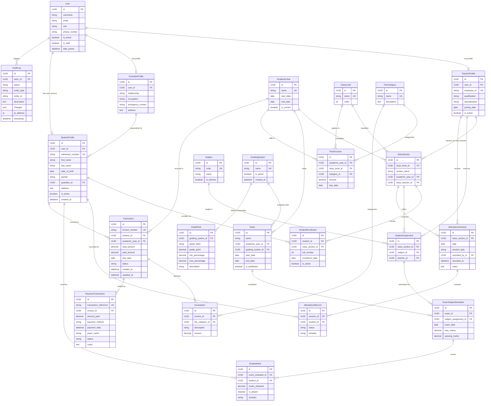

# Entity-Relationship (ER) Diagram & Database Architecture

This document describes the actual entity-relationship architecture of the **ALGIONS School Management System (SMS)** based on the Django models implemented in `apps/core`, `apps/academics`, `apps/attendance`, `apps/examinations`, and `apps/finance`.

---

## 1. Complete Mermaid ER Diagram

---

## 2. Key Database Constraints and Integrity Rules

### 2.1 Multi-Column Unique Constraints
- `ClassSection`: `UniqueConstraint(fields=['class_level', 'section_name', 'academic_year'])` prevents creating multiple identical sections within the same academic year.
- `SubjectAssignment`: `UniqueConstraint(fields=['class_section', 'subject'])` guarantees a subject is assigned to at most one instructional assignment per section.
- `StudentEnrollment`:
  - `UniqueConstraint(fields=['class_section', 'roll_number'])` guarantees no two students in a section share the same roll number.
  - `UniqueConstraint(fields=['student', 'class_section'])` guarantees a student cannot be enrolled multiple times in the same section.
- `AttendanceSession`: `UniqueConstraint(fields=['class_section', 'date', 'session_type'])` guarantees that a section can have at most one attendance register per date and session type (Acceptance Criterion 2).
- `AttendanceRecord`: `UniqueConstraint(fields=['session', 'student'])` guarantees no duplicate attendance marks for a student within a single session.
- `ExamSubjectSchedule`: `UniqueConstraint(fields=['exam', 'subject_assignment'])` ensures a subject is scheduled only once per examination.
- `StudentMark`: `UniqueConstraint(fields=['exam_schedule', 'student'])` ensures a student cannot receive duplicate marks for the same exam subject schedule.
- `FeeStructure`: `UniqueConstraint(fields=['academic_year', 'class_level', 'category'])` ensures unique pricing per fee category and grade level per year.

### 2.2 Database Engine Check Constraints
- `GradeRule`: `CheckConstraint(condition=Q(min_percentage__lte=F('max_percentage')))` prevents inverted percentage boundaries.
- `StudentMark`: `CheckConstraint(condition=Q(marks_obtained__gte=0))` prevents negative marks.
- `PaymentTransaction`: `CheckConstraint(condition=Q(amount_paid__gt=0))` guarantees payments are strictly positive amounts.

### 2.3 Foreign Key Protection Rules
- `on_delete=models.PROTECT`: Used on critical foreign keys (`StudentProfile.guardian`, `FeeInvoice.student`, `PaymentTransaction.invoice`, `StudentMark.student`, `StudentEnrollment.student`, `SubjectAssignment.teacher`) to prevent accidental cascade deletion of financial and academic records.
